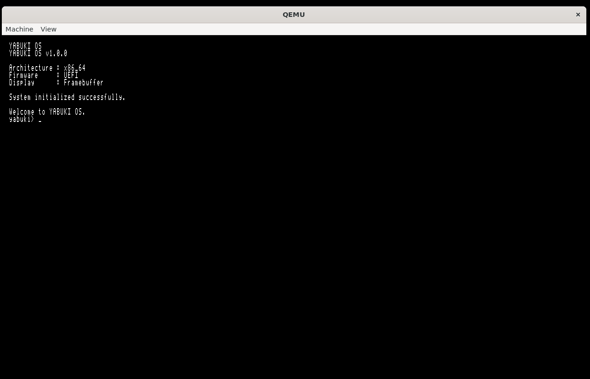

[English](README.md) | [日本語](README.ja.md)

# YabukiOS


YabukiOS is an operating system I am developing as a personal learning project.

YabukiOS is designed to run my own programming language, `.yabu`.

## Run YabukiOS

Build and run YabukiOS in an emulator.

```bash
make
make run
```

## Boot Screen

YabukiOS running in QEMU:



## Run YabukiOS on a Physical Computer

Build a bootable USB image.

```bash
make
make usb-image
```

Use [balenaEtcher](https://etcher.balena.io/) to flash the following image to a USB drive.

```text
build/yabuki-os-0.0.1-usb.img
```

### Select the Boot OS

1. Insert the USB drive into your computer.
2. Restart your computer.
3. Open the boot menu during startup.
4. Select the USB drive to boot YabukiOS.

The boot menu key varies depending on your computer's manufacturer. Common keys include `F7`, `F11`, `F12`, and `Esc`.

To boot your main operating system instead, remove the USB drive or select your main OS from the boot menu.

**Note:** YabukiOS currently requires an x86_64 computer with UEFI support. Secure Boot may need to be disabled.
